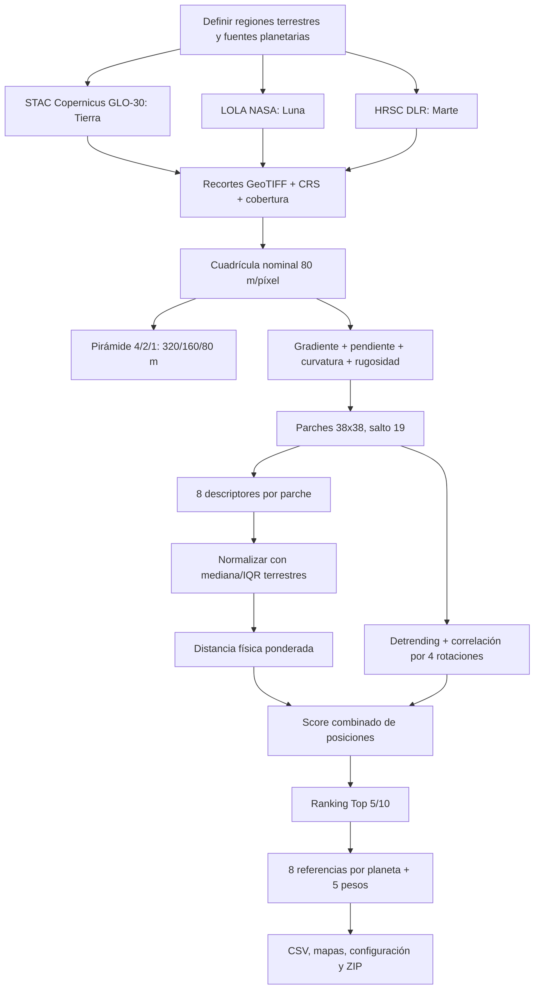
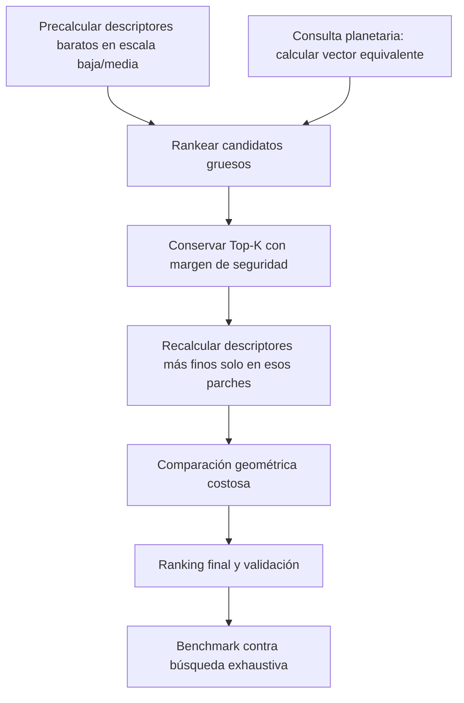

# HackNASA — Buscador de similitud topográfica Tierra–Luna–Marte

> **Documento técnico maestro del proyecto** · Versión 1.0 · 14 de noviembre de 2026  
> **Estado:** prototipo experimental funcional; la validez geológica de las recomendaciones sigue pendiente de evaluación.  
> **Equipo:** HackNASA (documentación para trabajo colaborativo).  
> **Entorno:** Python / Google Colab / Microsoft Planetary Computer + NASA LOLA + DLR/ESA HRSC.

**Cómo leer el documento:** [Resumen ejecutivo](#1-resumen-ejecutivo) · [Antecedentes](#2-historia-y-evolución-del-trabajo) · [Fuentes](#3-fuentes-de-datos-y-referencias-espaciales) · [Workflow](#5-workflow-integral) · [Metodología](#6-metodología-científica-y-ecuaciones) · [39 pasos](#7-guía-del-notebook-paso-a-paso) · [Resultados](#8-resultados-observados-en-la-ejecución-real) · [Limitaciones](#9-limitaciones-y-asuntos-por-corregir) · [Roadmap](#10-plan-de-trabajo-priorizado) · [Referencias](#14-fuentes-y-referencias).

### Registro de evidencia

Este README se basa en (a) el notebook `HackNASA_Automatico_39_Pasos_Sin_Drive.ipynb`, (b) los **19 archivos** del ZIP `Resultados_HackNASA_Tierra_Luna_Marte.zip` proporcionado por el equipo, (c) decisiones y experimentos de iteraciones anteriores descritos durante el desarrollo, y (d) documentación pública oficial listada al final. Las métricas marcadas **observadas** proceden del ZIP; las ideas de ampliación están etiquetadas **propuestas**, no realizadas.

## 1. Resumen ejecutivo

**Problema:** identificar regiones de la Tierra que compartan propiedades del relieve con un sitio seleccionado de la Luna o Marte. Una aplicación potencial es la **preselección de terrenos análogos** para planear pruebas de algoritmos, sensores o movilidad de exploradores robóticos. La analogía topográfica no equivale por sí sola a analogía geológica, mineralógica, mecánica ni de condiciones ambientales.

**Solución actual:**

1. Obtener modelos digitales de elevación (DEM/DTM/DSM) de la Tierra, Luna y Marte.
2. Leer los archivos georreferenciados, recortar áreas de estudio y preparar matrices a resolución nominal aproximada de **80 m/píxel**.
3. Calcular gradiente, pendiente, curvatura aproximada y rugosidad residual.
4. Dividir el relieve en **parches de 38 × 38 píxeles** (aprox. **3.04 × 3.04 km**) con **19 píxeles de salto** (50 % de solapamiento por eje).
5. Representar cada parche mediante **ocho descriptores topográficos**.
6. Comparar cada referencia planetaria frente a los candidatos terrestres por (i) distancia de características físicas y (ii) correlación de geometría espacial tras eliminar la pendiente general.
7. Combinar **posiciones de ranking** con pesos inicialmente 50/50; visualizar Top 5 y estudiar sensibilidad a los pesos.
8. Repetir en varias referencias y exportar mapas, tablas y configuración.

**Resultados reales del ZIP revisado:**

| Métrica | Valor observado |
|---|---:|
| Regiones terrestres | 4 (Monterrey, Atacama, Teide, Meteor Crater) |
| Parches terrestres | **170** |
| Parches lunares | **64** |
| Parches marcianos | **64** |
| Referencias lunares usadas en sensibilidad | **8** |
| Referencias marcianas usadas en sensibilidad | **8** |
| Búsquedas principales de múltiples referencias | **16** |
| Combinaciones referencia × peso | **80** |
| Filas en `rankings_completos.csv` | **2,720** (=16 × 170) |
| Archivos en ZIP de resultados | **19** |

**Interpretación obligatoria:** los resultados son un **ranking relativo dentro de un catálogo pequeño**, no porcentajes de identidad física ni validación geológica de sitios. La fase multiescala se genera, pero **todavía no filtra de manera jerárquica la búsqueda principal**; la CNN aún **no está implementada ni entrenada**.

## 2. Historia y evolución del trabajo

El proyecto se construyó incrementalmente. Esta cronología explica **por qué se tomaron las decisiones**, qué falló y qué se sustituyó; las estadísticas antiguas no deben confundirse con la última ejecución del hackathon.

| Etapa | Qué se desarrolló | Hallazgo/decisión | Estado |
|---|---|---|---|
| **A. Prototipo terrestre inicial** | Google Earth Engine + NASADEM de Monterrey. Elevación, gradiente, orientación, pendiente. | El DEM brinda datos numéricos para comparar geometría, no solo fotografías. | Histórico; sustituido para el conjunto terrestre actual. |
| **B. Multiescala inicial** | Baja/Media/Alta, curvatura y rugosidad normalizadas. | El profesor/equipo propuso comenzar en escala gruesa, usar pocos descriptores y realizar comparaciones detalladas únicamente donde valga la pena. | Base conceptual. |
| **C. Primeros parches** | En Monterrey se extrajeron **29 regiones** × 3 escalas = **87 vectores**. | Las propiedades locales se representan como filas tabulares. | Histórico. |
| **D. Evaluación de filtrado** | Búsqueda de similitud mediante distancia cuadrática ponderada y exclusión de parches superpuestos. | Baja–alta: Spearman **−0.100**; media–alta: **0.736** para el diagnóstico estudiado. | Hallazgo histórico. |
| **E. Corrección de filtrado** | Media → Alta, validación con 29 referencias y diferentes K. | Recuperación Top-3 promedio: K=3 **47.1 %**, K=5 **66.7 %**, K=8 **89.7 %**, K=10 **92.0 %**, K=15 **97.7 %**. | Resultado histórico, no benchmark del notebook actual. |
| **F. Primera Tierra–Luna** | DEM LOLA lunar, raster terrestre remuestreado, ocho rasgos, ranking físico. | Las estadísticas similares no implicaban que las imágenes tuvieran formas parecidas. | Iteración anterior. |
| **G. Geometría** | Correlación de elevación, prueba de 0/90/180/270°, ajuste y sustracción de plano. | La inclinación general podía inflar la correlación; los rankings físico y espacial diferían. | Integrado. |
| **H. Score combinado** | Combinación de posiciones en ranking físico y geométrico, sensibilidad a pesos. | El ranking es sensible a las ponderaciones y al catálogo de candidatos. | Integrado. |
| **I. HackNASA multiplanetario** | Microsoft Planetary Computer/Copernicus, NASA LOLA, DLR HRSC, notebook automático de 39 pasos sin Drive. | Pipeline reproducible en Colab; resultados reales en 4 zonas terrestres + Luna + Marte. | **Versión documentada aquí**. |

### Insumos metodológicos del profesor/equipo

- Utilizar **máscaras continuas normalizadas** en lugar de destruir información mediante umbrales binarios innecesarios.
- Probar una representación compacta: el diseño actual usa **8 valores por parche**.
- Organizar el análisis **grueso → fino**, con diferentes algoritmos/pesos según la escala, y evitar cómputo detallado en zonas descartables.
- Explorar CPU/GPU según el tamaño real de la base; por ahora no hay evidencia de que GPU sea indispensable.
- **Matiz computacional:** aumentar detalle puede multiplicar fuertemente el número de píxeles (si duplicamos resolución lineal, la imagen tiene ~4× más celdas); no todas las operaciones concretas del pipeline crecen matemáticamente de forma exponencial.

## 3. Fuentes de datos y referencias espaciales

### 3.1 Tierra — Copernicus DEM GLO-30

- **Proveedor científico:** Copernicus; el modelo se deriva principalmente de observaciones TanDEM-X y otras fuentes de apoyo.
- **Servicio empleado por el código:** Microsoft Planetary Computer, colección STAC `cop-dem-glo-30`.
- **Resolución nominal del producto fuente:** aprox. 30 m, aunque se distribuye como DEM GLO-30 en grilla geográfica (hay variación geográfica en la dimensión física de celda).
- **Naturaleza:** **DSM** (modelo digital de superficie, puede incluir vegetación e infraestructura), no garantía de terreno desnudo perfecto.
- **Recortes configurados:**

| Identificador del notebook | Ubicación de referencia | BBOX en lon/lat `[oeste,sur,este,norte]` | Motivo experimental |
|---|---|---|---|
| `Monterrey` | Nuevo León, México | `[-100.50, 25.55, -100.40, 25.65]` | Montañas, crestas, laderas y valles. |
| `Atacama` | Chile | `[-68.45, -23.50, -68.33, -23.40]` | Medio árido; el recorte actual es muy plano. |
| `Teide` | Tenerife, España | `[-16.72, 28.20, -16.58, 28.32]` | Paisaje volcánico y desnivel importante. |
| `MeteorCrater` | Arizona, EE. UU. | `[-111.08, 34.97, -110.96, 35.09]` | Región de cráter de impacto. |

**Elección de las cuatro zonas:** una muestra pequeña y contrastante para demostrar extremo a extremo la adquisición y comparación; **no** supone que sean los mejores análogos terrestres conocidos. Puede ampliarse a 100 o más áreas, procurando diversidad y controlar descargas/cómputo.

### 3.2 Luna — LOLA/LRO

- **Instrumento:** Lunar Orbiter Laser Altimeter (LOLA), Lunar Reconnaissance Orbiter (LRO), NASA.
- **Producto:** `LDEM_80S_80MPP_ADJ.TIF` (archivo del polo sur lunar, cobertura de ~80° S a 90° S).
- **Resolución del archivo:** 80 m/píxel.
- **Formato y CRS:** GeoTIFF cloud-optimized (COG), coordenadas estereográficas polares sur referidas a la Luna, expresadas en metros.
- **URL del código:** https://pgda.gsfc.nasa.gov/data/LOLA_20mpp/LDEM_80S_80MPP_ADJ.TIF
- **Página científica:** https://pgda.gsfc.nasa.gov/products/90
- **El notebook NO analiza todo el hemisferio ni toda la Luna:** selecciona un **recorte local de ~15×15 km** tras evaluar unas ventanas candidatas.
- **Validación futura posible:** incorporar productos LOLA de resolución efectiva, error y/o recuento de puntos, publicados junto al DEM.

### 3.3 Marte — HRSC/Mars Express

- **Instrumento/producto:** High Resolution Stereo Camera (HRSC), misión Mars Express, ESA; producto cartográfico distribuido por DLR.
- **Archivo del código:** `HMC_11E10_da5.tif` de la cuadrícula regional MC11E.
- **Tipo `da5`:** modelo digital de terreno con alturas referidas al **areoide** marciano. No confundir con `co5` (imagen de colores), `da5cs` (relieve coloreado) ni con `dt5` (referencia al esferoide).
- **Resolución nominal de fuente:** 50 m/píxel.
- **URL del código:** https://hrscteam.dlr.de/public/data/HMC30/MC11E/HMC_11E10_da5.tif
- **Catálogo oficial:** https://hrscteam.dlr.de/public/data/regionaldtms.php
- **Nuestro recorte:** ~15×15 km con cuadrícula de **~79.79 m en coordenadas proyectadas**.

**Advertencia prioritaria de proyección:** la tesela marciana usa una proyección equirectangular con paralelo estándar 0°. En el recorte actual (latitud cercana a 26°), la distancia física este–oeste puede ser del orden de `79.79 × cos(26°) ≈ 71.7 m`, aun si la cuadrícula proyectada indica 79.79 m. Debemos corregir la métrica o reproyectar a una proyección local apropiada antes de interpretar rigurosamente pendientes/rugosidades entre cuerpos.

### 3.4 ¿Qué significa GeoTIFF, STAC y tesela?

- **GeoTIFF:** raster + geotransformación, CRS, unidades, metadatos, NoData. Un píxel del raster de elevación **no** representa necesariamente un color, sino un número de altura.
- **Tesela:** fragmento del mosaico global. El buscador STAC identifica las teselas que intersectan la BBOX sin descargar el planeta completo.
- **STAC:** estándar para catalogar y buscar datos geoespaciales por ubicación/colección. Los activos de Microsoft se firman automáticamente con `planetary_computer.sign_inplace` antes de leerlos.
- **UTM:** sistema de coordenadas proyectadas en metros para los recortes **terrestres**. Luna/Marte usan CRS planetarios diferentes. Nunca asignar un EPSG terrestre a un archivo planetario.
- **Datum vertical:** altura medida respecto a una superficie de referencia definida por cada dataset. Por ello evitamos usar diferencia directa de alturas absolutas Tierra–Luna–Marte como métrica.

## 4. Datos de entrada, parámetros y salidas

### 4.1 Parámetros fijados en el notebook actual

| Variable | Valor usado | Razón y consecuencias |
|---|---:|---|
| `RES_M` | 80 m/píxel | Base nominal de comparación entre fuentes; no implica igual calidad efectiva. |
| `TAM_PIX` | 38 píxeles | Parche de 3,040 m por lado (~9.2416 km²). |
| `SALTO_PIX` | 19 píxeles | Desplazamiento 1,520 m; 50 % de traslape en cada eje. |
| `COBERTURA_MIN` | 0.85 | Descartar parches con menos de 85 % de datos válidos. |
| `PESO_FISICO` | 0.5 | Combinación físico/forma 50/50, provisional. |
| `CANDIDATOS_GEOM` | `None` | Comparar geométricamente **todos** los candidatos terrestres; aún sin filtro eficiente. |
| `ventana` de rugosidad | 5×5 | Vecindario de ~400×400 m a resolución nominal 80 m. |
| Factores pirámide | `(4, 2, 1)` | 320 / 160 / 80 m nominales, en niveles bajo / medio / alto. |
| Rotaciones de comparación | 0°, 90°, 180°, 270° | Permitir orientaciones distintas sin registrar deformaciones arbitrarias. |
| Pruebas de peso físico | 0, .25, .50, .75, 1.0 | Estudio de sensibilidad respecto al 50/50. |
| Referencias multiparche | Hasta 8 por planeta | Evaluación exploratoria de diferentes pendientes. |

**Cuidado al ampliar a 100 zonas:** el tamaño del catálogo crecería mucho. A modo ilustrativo, el promedio actual es 170/4 = **42.5 parches por zona**; 100 recortes semejantes darían ~4,250 parches, pero esto es **proyección**, no un resultado medido.

### 4.2 Archivos generados y significado

El ZIP de resultados examinado contiene **19 elementos**:

```text
Resultados_HackNASA_Tierra_Luna_Marte.zip
├── tierra_Monterrey.tif
├── tierra_Atacama.tif
├── tierra_Teide.tif
├── tierra_MeteorCrater.tif
├── luna_recorte_80m.tif
├── marte_recorte_80m.tif
├── vectores_tierra.csv
├── vectores_luna.csv
├── vectores_marte.csv
├── ranking_luna_tierra.csv
├── ranking_marte_tierra.csv
├── rankings_completos.csv
├── resumen_multi_planetario.csv
├── sensibilidad_pesos.csv
├── top5_luna.png
├── top5_marte.png
├── comparaciones_luna.png
├── comparaciones_marte.png
└── configuracion.json
```

| Familia | Qué contiene | Cómo se usa |
|---|---|---|
| `tierra_*.tif`, `*_recorte_80m.tif` | Elevaciones, transformaciones, CRS. | Reprocesar terreno y reproducir figuras. |
| `vectores_*.csv` | Una fila por parche; IDs, región, posición, cobertura y ocho estadísticas. | Construir/comparar descriptores. |
| `ranking_*_tierra.csv` | Ranking de la **primera referencia** de cada cuerpo, 170 candidatos. | Inspección de Top 5/10. |
| `rankings_completos.csv` | Todas las comparaciones de las 16 referencias, 2,720 filas. | Análisis global y auditoría. |
| `resumen_multi_planetario.csv` | Mejor candidato por referencia, 16 filas. | Presentación de patrones generales. |
| `sensibilidad_pesos.csv` | 80 combinaciones de referencias y pesos. | Analizar dependencia de las ponderaciones. |
| Figuras PNG | Comparaciones gráficas con rotaciones. | Presentación y análisis cualitativo. |
| `configuracion.json` | Valores del experimento. | Trazabilidad y reproducción. |

Los códigos fuente exactos están en `HackNASA_Automatico_39_Pasos_Sin_Drive.ipynb` (Colab) y el `.py` del mismo nombre. Este README **documenta**, pero no sustituye al notebook ejecutable.

## 5. Workflow integral

### 5.1 Diagrama de flujo actual



**Estado del diagrama:** la pirámide (G) se genera y diagnostica, pero **no se conecta actualmente como filtro que descarte candidatos antes de H/M**. La ruta de búsqueda implementada recorre todas las ventanas a resolución alta (80 m) y compara sus características; `CANDIDATOS_GEOM=None` implica comparación geométrica exhaustiva dentro de los 170 candidatos.

### 5.2 Workflow de optimización propuesto (todavía no implementado)



Validar **recuperación@K**, correlación entre escalas y tiempos reales antes de afirmar ahorro. Nuestra prueba histórica mostró que el nivel más grueso podía descartar los mejores candidatos.

## 6. Metodología científica y ecuaciones

### 6.1 Preparación y comparabilidad de píxeles

Sea `H(y,x)` el DEM, altura en metros respecto al datum correspondiente. En una cuadrícula métrica local con pasos `Δx`, `Δy`, calculamos derivadas horizontales. El objetivo nominal es `Δx ≈ Δy ≈ 80 m`. Para Marte, la proyección debe revisarse antes de asumir esas distancias físicas en todas las direcciones.

**Reproyección/remuestreo terrestre:** se obtienen elevaciones de Copernicus, se mosaican teselas que intersectan el recorte, se reproyectan a UTM local y se remuestrean mediante promedio (`Resampling.average`). Esto suaviza detalles finos: subir artificialmente una fuente de 80 m a 30 m no recuperaría información.

**Cobertura:**

$$\operatorname{Cobertura}=100\,\frac{\#\{\text{píxeles con valor válido}\}}{\#\{\text{píxeles totales}\}}.$$ 

100 % de cobertura implica datos presentes, **no** precisión perfecta ni incertidumbre nula.

### 6.2 Gradiente, orientación y pendiente

$$H_x=\frac{\partial H}{\partial x},\quad H_y=\frac{\partial H}{\partial y}.$$

$$G=\sqrt{H_x^2+H_y^2},\qquad \alpha=\arctan(G)\frac{180}{\pi}.$$

El gradiente es una magnitud en m/m (adimensional si ambas magnitudes se miden en metros). La pendiente `α` se expresa en grados. La orientación teórica del máximo incremento de altura es $\theta=\operatorname{atan2}(H_y,H_x)$, que apareció en el primer prototipo; **el notebook de 39 pasos no la incluye como uno de los ocho rasgos finales**.

Se utiliza un suavizado gaussiano de `sigma=1` antes de las derivadas para reducir ruido, a costa de perder algunos detalles.

### 6.3 Curvatura aproximada

$$C\approx H_{xx}+H_{yy}.$$

La suma de derivadas segundas es el **laplaciano** del terreno, con unidades aproximadas `1/m` si `H` y `x,y` están en metros. Valores positivos y negativos indican diferentes comportamientos locales de concavidad/convexidad según convenio. **No representa por sí sola todas las curvaturas geomorfológicas** (perfil, plano, etc.). En los vectores se usa el valor absoluto para enfatizar intensidad.

### 6.4 Rugosidad residual a plano local

Para cada vecindario 5×5 ajustamos un plano $\hat H(x,y)=ax+by+c$ y estimamos el RMS residual:

$$R=\sqrt{\frac{1}{N}\sum_{i=1}^N\left(H_i-\hat H_i\right)^2}.$$

El código lo calcula eficientemente mediante momentos de ventanas locales y convoluciones; no hace una regresión separada lenta por cada píxel. La rugosidad representa desviación respecto a un plano **no** diferencia entre altura mínima y máxima. Sus unidades son metros.

**Prueba unitaria (paso 15):** con $H=1000+0.8X+0.4Y$ (índices de matriz `X,Y`) tenemos un plano perfecto. Su rugosidad debe ser casi cero; el código exige mediana por debajo de `0.001` (tolerancia numérica). Esta prueba verifica **esa propiedad** y no valida todos los casos geológicos posibles.

### 6.5 Pirámides multiescala

Desde una malla a ~80 m obtenemos niveles de factores `(4,2,1)`, aproximadamente 320, 160 y 80 m. Al duplicar tamaño lineal de celda, hay alrededor de cuatro veces menos píxeles; al cuadruplicarlo, alrededor de 16 veces menos. El objetivo futuro es filtrar por costo creciente.

**No confundir:** la resolución espacial de la cuadrícula, la resolución efectiva del instrumento y la certeza de elevación son atributos distintos. El producto LOLA publica capas de resolución efectiva e incertidumbre que podrían incorporarse.

### 6.6 Parches y estadística compacta

Cada parche es una ventana de `38 × 38 = 1,444` píxeles, con lado nominal `38 × 80 = 3,040 m` y área `9.2416 km²`. El salto de 19 px equivale a 1,520 m; ventanas consecutivas comparten la mitad del ancho/alto, y no son independientes.

Solo se conserva un parche con al menos `85 %` de píxeles donde coinciden valores válidos de pendiente, curvatura y rugosidad. Cada parche genera:

| Descriptor | Significado | Unidad aproximada |
|---|---|---|
| `pendiente_media` | Promedio de inclinación | ° |
| `pendiente_std` | Desviación estándar de pendiente | ° |
| `pendiente_p90` | Percentil 90 de pendiente | ° |
| `curvatura_abs_media` | Media de `|C|` | 1/m |
| `curvatura_abs_p90` | Percentil 90 de `|C|` | 1/m |
| `rugosidad_mediana` | Mediana de irregularidad residual | m |
| `rugosidad_p90` | Percentil 90 de rugosidad | m |
| `rugosidad_std` | Desviación estándar de rugosidad | m |

Al comprimir `1,444` elevaciones en ocho estadísticas perdemos la **distribución espacial**: dos superficies distintas pueden compartir descriptores. Por ello añadimos un segundo criterio geométrico.

### 6.7 Normalización común y pesos

Calculamos con el **conjunto terrestre** una mediana y rango intercuartílico por rasgo; usamos los mismos parámetros para Tierra, Luna y Marte:

$$z_i=\frac{x_i-\operatorname{Mediana}_{\mathrm{Tierra},i}}{\operatorname{IQR}_{\mathrm{Tierra},i}},\quad \mathrm{IQR}=Q_{75}-Q_{25}.$$

Si el IQR es cercano a cero, el código lo reemplaza por 1 para evitar división por cero. Esto es un respaldo técnico; no garantiza que el rasgo sea informativo.

Damos **un tercio del peso total a cada familia**: pendiente (tres rasgos, peso individual 1/9), curvatura (dos rasgos, 1/6) y rugosidad (tres rasgos, 1/9). Es una hipótesis inicial; el peso de familias y el peso físico/geométrico requieren validación.

### 6.8 Distancia física ponderada

$$D_f(A,B)=\frac{\sum_{i=1}^8 w_i\bigl(z_i(A)-z_i(B)\bigr)^2}{\sum_{i=1}^8 w_i}.$$

**Menor `D_f` = vectores más cercanos en estas ocho medidas.** No implica que los terrenos sean geológicamente iguales.

Para la primera demostración (paso 24) se elige como referencia planetaria el parche cuya `pendiente_media` está más próxima a la **mediana de pendiente media** de todos los parches de su propio cuerpo. No selecciona automáticamente un sitio de aterrizaje ni un cráter científicamente validado.

### 6.9 Correlación geométrica, detrending y rotación

Se obtiene cada parche real `H` de `38×38`, se ajusta un plano $ax+by+c$ por mínimos cuadrados y se resta:

$$H_{\mathrm{res}}(x,y)=H(x,y)-(ax+by+c).$$

Tras un suavizado ligero se compara con cuatro rotaciones de otro parche. Se utiliza correlación normalizada centrada:

$$\rho(A,B)=\frac{\sum_{p}(A_p-\bar A)(B_p-\bar B)}{\sqrt{\sum_p(A_p-\bar A)^2}\sqrt{\sum_p(B_p-\bar B)^2}}.$$

**Mayor `ρ` = patrones residuales más correlacionados**. El máximo se escoge entre 0°, 90°, 180° y 270°. Una correlación 0.9 **no** es 90 % de identidad. El detrending retira una pendiente general que podría generar falsas similitudes, pero para un rover dicha pendiente puede importar; por eso permanecen las métricas físicas originales.

### 6.10 Ranking combinado (no calibrado)

Se convierten **puestos** de cada ranking, sobre N candidatos válidos, en números entre 0 y 1:

$$R_f=\frac{\operatorname{rank}(D_f)-1}{N-1},\qquad R_g=\frac{\operatorname{rank}(-\rho)-1}{N-1}.$$

$$S_{\mathrm{final}}=w_f R_f+(1-w_f)R_g,\qquad w_f=0.5\ \text{inicialmente}.$$

**Menor score = mejor puesto relativo**. Por ejemplo `0.0296` **no significa 97.04 % de similitud**. Los valores de `S_final` no son comparables directamente entre catálogos de tamaños distintos ni equivalen a probabilidades físicas.

### 6.11 Pruebas de sensibilidad

Para cada una de hasta 8 referencias lunares y 8 marcianas probamos `w_f ∈ {0,.25,.5,.75,1}`. Se compara el Top 1 y el conjunto Top 3 con la configuración base 50/50.

$$J(A,B)=\frac{|A\cap B|}{|A\cup B|}$$

`Jaccard Top-3` mide estabilidad de miembros, **no recuperación de verdad geológica**. Por construcción, en `w_f=0.5` el Top 1 y el conjunto Top-3 coinciden al 100 % con su referencia 50/50.

## 7. Guía del notebook paso a paso

Cada fila identifica el **paso real del notebook de 39 celdas** y distingue salida observada de interpretación.

### A. Preparación y terrestre (1–7)

| Paso | Qué hace el código | Salida esperada / observada | Cómo interpretarla / control |
|---|---|---|---|
| **1. Instalar dependencias** | Instala `pystac-client`, `planetary-computer`, Rasterio, SciPy, Pandas y Matplotlib. | Salida de instalación; no es un resultado científico. | Si falla instalación, no avanzar a los imports. |
| **2. Importar librerías** | Carga NumPy, Rasterio, transformaciones, `ndi`, Matplotlib, cliente STAC. | No debe generar error; funciones disponibles. | `ModuleNotFoundError` implica ejecutar paso 1. |
| **3. Parámetros** | Define `RES_M`, BBOX, parche, salto, cobertura, pesos y salida. | “Configuración lista: 80.0 m/px, 4 regiones terrestres”. | Cambios aquí repercuten en TODOS los pasos. |
| **4. Funciones Copernicus** | `utm_epsg`, `bajar_copernicus`: busca teselas, reproyecta a UTM, remuestrea y mosaica. | Define funciones, sin mapa. | Coordenadas finales en metros por región, no grados. |
| **5. Descargar Tierra** | Conecta a STAC y obtiene los cuatro recortes. | Número de teselas y dimensiones por zona. | Si se descargan menos de cuatro, revisar los mensajes y no asumir catálogo completo. |
| **6. Calidad terrestre** | Imprime dimensiones, fracción finita, resolución y mínimo–máximo. | Tabla de 4 líneas; cobertura 100 % en el ZIP. | Cobertura no mide incertidumbre; el rango ayuda a detectar recortes planos/erróneos. |
| **7. Mapas de elevación** | Plotea recortes terrestres. | Cuatro mapas con barra de elevación cada uno. | Inspección visual de geografía; colores de diferentes barras no siempre equivalentes. |


### B. Planetarios y multiescala (8–13)

| Paso | Qué hace el código | Salida esperada / observada | Cómo interpretarla / control |
|---|---|---|---|
| **8. Configurar fuentes** | Define URLs oficiales LOLA/HRSC, lectura remota, límite de descarga y `REQUERIR_MARTE`. | Mensajes con fuentes y resolución nominal. | No requiere Google Drive; servidores externos podrían fallar. |
| **9. Funciones de lectura** | Valida un GeoTIFF métrico de una banda; intenta recorte remoto y fallback con descarga. | “Funciones de lectura automática listas”. | Un TIFF RGB/CRS geográfico no debe procesarse como DEM métrico. |
| **10. Obtener Luna y Marte** | Selecciona una ventana con relieve y cobertura, lee un recorte y lo guarda. | Dos mapas planetarios; en ZIP ambos son 188×188. | No usa todo el planeta: solo ventanas dentro de productos regionales. |
| **11. Calidad planetaria** | Imprime matriz, pasos nominales, porcentaje finito y rango. | Mallas 188×188; Luna 80 m; Marte ~79.79 m. | Corregir distorsión cartográfica de Marte antes de inferencias físicas definitivas. |
| **12. Crear pirámides** | Remuestrea cada DEM en factores 4,2,1. | Tamaños y pasos de pixel a cada nivel. | La pirámide existe pero NO filtra el ranking principal. |
| **13. Ver 3 escalas** | Presenta un recorte terrestre con 320/160/80 m nominales. | Tres vistas del mismo terreno. | Confirma pérdida/retención de patrones con escala. |


### C. Física del relieve y máscaras (14–19)

| Paso | Qué hace el código | Salida esperada / observada | Cómo interpretarla / control |
|---|---|---|---|
| **14. Funciones topográficas** | Calcula gradiente, pendiente, laplaciano y rugosidad residual a plano 5×5. | Función `caracteristicas_dem` definida. | Derivadas requieren distancias físicas horizontales fiables. |
| **15. Prueba de plano** | Construye `H=1000+0.8X+0.4Y` y comprueba rugosidad ~0. | “Prueba de plano: OK”. | Prueba un caso simple, no certifica calidad de datos planetarios. |
| **16. Calcular los 6 terrenos** | Obtiene las 4 capas derivadas para Tierra/Luna/Marte. | Pendiente mediana y rugosidad mediana por DEM. | Chequeo general del carácter suave o accidentado del recorte. |
| **17. Mapas derivados** | Muestra H, pendiente, curvatura y rugosidad por DEM. | Cuatro mapas por terreno con barras. | Permite encontrar artefactos, ruido, bordes y estructuras. |
| **18. Máscaras continuas** | Escala curvatura/rugosidad por percentil 98 y forma máscara booleana útil. | “Cobertura útil” en porcentaje. | Las escalas por terreno son visuales; NO comparar como magnitudes físicas universales. |
| **19. Ver máscaras** | Muestra la primera referencia planetaria en capas normalizadas. | Dos mapas curvatura/rugosidad. | Distribución espacial de áreas curvas e irregulares. |


### D. Parches, vectorización y física (20–25)

| Paso | Qué hace el código | Salida esperada / observada | Cómo interpretarla / control |
|---|---|---|---|
| **20. Definir parches** | Ventana 38×38, salto 19, validez≥85 %, resumen a 8 descriptores. | Función `crear_parches` sin tabla hasta ejecutarla. | Los parches superpuestos no son muestras independientes. |
| **21. Generar vectores** | Recorre 4 recortes Tierra y uno Luna/Marte. | 170 / 64 / 64 filas (ZIP real). | La mayor cantidad terrestre responde a cuatro áreas, no mayor calidad. |
| **22. Ubicar parches** | Imprime IDs, cobertura y puntos sobre DEM. | Puntos de centros y conteos por zona. | Control espacial de ventanas y posiciones. |
| **23. Normalizar** | Mediana/IQR terrestres; mismos parámetros para los otros cuerpos, pesos por familia. | Vectores normalizados 170,64,64. | Evita que unidades distintas dominen la distancia. |
| **24. Ranking físico inicial** | Selecciona referencia por mediana de pendiente y compara 8 rasgos. | Top 5 por distancia física para Luna y Marte. | Menor distancia no equivale a sitio geológicamente óptimo. |
| **25. Contribuciones** | Descompone aportes al score físico para 3 candidatos del primer cuerpo (Luna). | Tabla y mapa de calor por descriptor. | Explica qué rasgos producen la distancia; no se ejecuta para Marte en este paso. |


### E. Geometría y combinación (26–32)

| Paso | Qué hace el código | Salida esperada / observada | Cómo interpretarla / control |
|---|---|---|---|
| **26. Extraer imagen parche** | Obtiene matriz 38×38 de elevaciones desde ID/fila/col. | Función `parche`. | Recupera organización espacial que pierde el vector de 8 números. |
| **27. Detrending** | Ajusta y sustrae plano con mínimos cuadrados. | Función `sin_plano`. | Resalta estructuras locales y deja de lado pendiente general para este criterio. |
| **28. Correlación rotacional** | Compara residuales suavizados con 4 rotaciones. | `corr_forma` devuelve correlación y ángulo. | Correlación alta no equivale a misma geología. |
| **29. Rankings separados** | Construye un Top físico y uno geométrico para cada referencia. | Dos tablas Top-5 por cuerpo. | Las dos métricas pueden elegir distintas zonas. |
| **30. Combinar rangos** | Normaliza posiciones [0,1] y mezcla con peso 0.5. | Funciones `combinar` y `buscar`. | Score final es ordinal/relativo, nunca porcentaje de identidad. |
| **31. Rankings combinados** | Ejecuta `buscar` para primera referencia de cada cuerpo. | Top-10 Luna–Tierra y Marte–Tierra. | En ZIP: Teide primero en ambas primeras referencias. |
| **32. Visualizar Top 5** | Muestra residual planetario junto a 5 residuales terrestres rotados. | `top5_luna.png`, `top5_marte.png`. | Inspección cualitativa; gráficos no muestran pendiente general. |


### F. Sensibilidad, diagnóstico y exportación (33–39)

| Paso | Qué hace el código | Salida esperada / observada | Cómo interpretarla / control |
|---|---|---|---|
| **33. Múltiples referencias** | Elige hasta 8 por cuerpo, evitando traslape, y calcula 5 pesos. | 16 referencias ×170 resultados; 80 registros de peso. | Representa diferentes pendientes, no validación geológica independiente. |
| **34. Tablas resumen** | Agrupa mejor candidato por referencia, y estabilidad Top 1/Top 3. | `resumen_multi_planetario`, tabla de sensibilidad. | 50/50 produce 100 % por autocomparación, no exactitud. |
| **35. Graficar sensibilidad** | Curvas de coincidencia Top1/Jaccard Top3 por peso. | Gráficos comparables Luna–Marte. | Cuantifica dependencia de parámetros, no determina el mejor peso. |
| **36. Ejemplos visuales** | Muestra pares Luna/Marte con mejores candidatos terrestres. | `comparaciones_luna.png`, `comparaciones_marte.png`. | Permite inspección de estructuras para presentación. |
| **37. Diagnóstico multiescala** | Genera parches a varias escalas en un DEM terrestre. | Conteos de parches válidos por escala. | NO calcula recuperación entre rankings ni ahorro de tiempo. |
| **38. Métrica de tamaño** | Imprime número de DEMs, candidatos y memoria de matrices. | Totales y memoria en bytes/MB aproximados. | Aunque importa `time`, NO mide duración real con cronómetro. |
| **39. Exportación** | Guarda GeoTIFF, CSV, PNG y JSON; empaqueta ZIP. | ZIP con 19 archivos en la ejecución observada. | Permite reproducibilidad parcial y compartir análisis. |

## 8. Resultados observados en la ejecución real

> Todas las cantidades de esta sección fueron calculadas a partir del **ZIP de resultados proporcionado**; no son valores estimados ni impresiones de imágenes.

### 8.1 Cobertura, tamaño, píxel y rangos

| Recorte | Dimensiones (filas×columnas) | Res. de cuadrícula | Píxeles finitos | Elevación mín.–máx. (m) |
|---|---:|---:|---:|---:|
| Monterrey | 140×128 | 80.00 m | 100.0 % | 674.2 a 2460.2 |
| Atacama | 140×154 | 80.00 m | 100.0 % | 2299.0 a 2328.4 |
| Teide | 169×174 | 80.00 m | 100.0 % | 1299.8 a 3693.0 |
| Meteor Crater | 167×137 | 80.00 m | 100.0 % | 1554.8 a 1738.9 |
| Luna | 188×188 | 80.00 m | 100.0 % | -2843.6 a 1736.8 |
| Marte | 188×188 | 79.79 m | 100.0 % | -3436.0 a -1869.0 |

Los valores marcianos son del CRS proyectado; la distancia real entre celdas requiere el ajuste métrico mencionado. La cobertura numérica no indica precisión radiométrica/altimétrica.

### 8.2 Parches por origen

| Fuente | Cantidad de parches |
|---|---:|
| Tierra – Atacama | 42 |
| Tierra – MeteorCrater | 42 |
| Tierra – Monterrey | 30 |
| Tierra – Teide | 56 |
| Luna | 64 |
| Marte | 64 |

Los 170 parches terrestres provienen de **4 zonas**. El total de 64 parches en cada cuerpo corresponde a una cuadrícula de **8×8 ventanas** en cada recorte de 188×188 píxeles con tamaño 38 y salto 19.

### 8.3 Medianas descriptivas (de estadísticas por parche)

| Conjunto | Mediana de `pendiente_media` (°) | Mediana de `rugosidad_mediana` (m) |
|---|---:|---:|
| Tierra | 5.05 | 3.17 |
| Luna | 17.93 | 1.96 |
| Marte | 5.56 | 2.19 |

Estos resúmenes caracterizan **los recortes elegidos**, no la totalidad de la Tierra, la Luna ni Marte.

### 8.4 Rankings combinados de la primera referencia por planeta

**Luna — referencia `L_038_095`** (Top 5 de los 170 candidatos)

| # | Región/Parche | Distancia física | Correlación geométrica | Score final |
|---:|---|---:|---:|---:|
| 1 | `T_Teide_076_019` | 0.0594 | 0.6913 | **0.0296** |
| 2 | `T_Teide_095_076` | 0.0521 | 0.6518 | **0.0385** |
| 3 | `T_Teide_076_038` | 0.1310 | 0.8398 | **0.0592** |
| 4 | `T_Teide_019_019` | 0.1330 | 0.7523 | **0.0740** |
| 5 | `T_Teide_019_000` | 0.1253 | 0.6506 | **0.0888** |

**Marte — referencia `M_114_019`** (Top 5 de los 170 candidatos)

| # | Región/Parche | Distancia física | Correlación geométrica | Score final |
|---:|---|---:|---:|---:|
| 1 | `T_Teide_019_133` | 0.0220 | 0.5972 | **0.0533** |
| 2 | `T_MeteorCrater_057_000` | 0.0615 | 0.5382 | **0.1036** |
| 3 | `T_MeteorCrater_019_076` | 0.0920 | 0.6451 | **0.1302** |
| 4 | `T_MeteorCrater_076_000` | 0.0591 | 0.4778 | **0.1331** |
| 5 | `T_MeteorCrater_000_019` | 0.0869 | 0.5390 | **0.1538** |

**Lectura científica:** el “mejor” candidato es el primero **dentro del catálogo y la ponderación actuales**. No hay etiqueta independiente de verdad terreno-análogo ni calibración probabilística del score.

### 8.5 Pruebas multilunares/multimarcianas

- **Luna**: 8 referencias; mejor región terrestre: Teide en 7/8, MeteorCrater en 1/8.
- **Marte**: 8 referencias; mejor región terrestre: MeteorCrater en 5/8, Teide en 3/8.

### 8.6 Sensibilidad real de pesos (vs. 50/50)

| Cuerpo | Peso físico | Coincidencia Top 1 (%) | Jaccard Top 3 (%) |
|---|---:|---:|---:|
| Luna | 0 % | 0.00 | 26.25 |
| Luna | 25 % | 62.50 | 67.50 |
| Luna | 50 % | 100.00 | 100.00 |
| Luna | 75 % | 75.00 | 55.00 |
| Luna | 100 % | 37.50 | 18.75 |
| Marte | 0 % | 0.00 | 2.50 |
| Marte | 25 % | 50.00 | 58.75 |
| Marte | 50 % | 100.00 | 100.00 |
| Marte | 75 % | 37.50 | 38.75 |
| Marte | 100 % | 12.50 | 8.75 |

La configuración 50/50 siempre coincide consigo misma, por definición. Esto **no** demuestra que 50/50 sea óptima. Las divergencias con pesos extremos muestran que la clasificación es sensible a decisiones de diseño.

### 8.7 Figuras incluidas en el paquete documental

Las figuras siguientes provienen del ZIP real. Para visualizarlas en Markdown, usar el paquete `Documentacion_HackNASA_con_figuras.zip` que acompaña este README.

**Top 5 lunar**  


**Top 5 marciano**  


**Referencias lunares**  


**Referencias marcianas**  


## 9. Limitaciones y asuntos por corregir

| ID | Limitación/hallazgo | Efecto posible | Cómo resolver / verificar | Prioridad |
|---|---|---|---|---|
| L1 | **Proyección equirectangular marciana** usa metros de cuadrícula, pero no necesariamente distancias locales iguales en X/Y. | Sesgo en pendiente, curvatura, rugosidad y tamaño físico de parche. | Reproyectar el recorte a una proyección local adecuada de Marte o introducir factores métricos espaciales; verificar con distancias geodésicas. | **Crítica** |
| L2 | **La pirámide no filtra realmente** la búsqueda principal. | No se ha demostrado ahorro computacional del coarse-to-fine. | Implementar descarte progresivo, medir recuperación@K y tiempo frente a exhaustiva. | Alta |
| L3 | **Catálogo terrestre pequeño** (4 regiones, 170 parches superpuestos). | Sesgo hacia Teide/Meteor Crater y ausencia de análogos posiblemente mejores. | Ampliar zonas de relieve variadas y estratificadas. | Alta |
| L4 | **No hay verdad terreno-análogo externa.** | No se puede afirmar precisión geológica ni utilidad rover. | Crear etiquetas/criterios geológicos, validar con expertos y referencias de terreno. | Alta |
| L5 | **Peso 50/50 no validado.** | Ranking inestable frente a ponderaciones. | Análisis de sensibilidad, criterio de selección externo, reportar ambas métricas por separado. | Alta |
| L6 | **Distinta resolución efectiva y error de medición** entre fuentes. | Estructuras pueden desaparecer o verse distintas por instrumento/remuestreo. | Incorporar incertidumbres, mapas de resolución efectiva y validación por escala. | Alta |
| L7 | **DSM terrestre** incluye estructuras no geológicas en algunos lugares. | Valores de rugosidad/similaridad pueden reflejar vegetación o infraestructura. | Priorizar superficies expuestas, máscaras temáticas o DEMs de terreno desnudo cuando proceda. | Media |
| L8 | **Parche fijo de 3.04 km** y correlación con cuatro rotaciones. | Puede perder estructuras de otros tamaños/orientaciones; correlación alta de patrón no implica proceso geológico igual. | Probar 1/3/10 km, variantes de orientación, HOG/gradientes/crestas; contrastar con criterio externo. | Media |
| L9 | **Parches vecinos se solapan.** | Sobreestima tamaño de muestra independiente; fuga de información al entrenar/validar ML. | Separación geográfica por zona/bloques al crear particiones de datos. | Alta antes de CNN |
| L10 | **No existe una CNN entrenada.** | No podemos afirmar que el sistema use deep learning para recuperar terrenos. | Diseñar embeddings/siamesa/auto-supervisado, etiquetar pares y usar baselines. | Futura fase |
| L11 | **Paso 25 solo diagnostica el primer planeta**; paso 38 no cronometra realmente. | Cobertura de diagnóstico y evidencia de rendimiento incompletas. | Bucle por planeta y `time.perf_counter()` / memoria pico. | Media |
| L12 | **Selección automática de referencia por mediana de pendiente** y ventanas de mayor variación de elevación. | Prueba casos convenientes, no sitios científicos priorizados. | Permitir coordenadas/selección de ROI, incluir casos difíciles y criterios de misión. | Alta |

### Riesgos al interpretar los resultados

- Un `score_final` **0** significa primer lugar simultáneo en ambos rankings, **no** terrenos idénticos.
- Una `corr_forma` **0.84** no equivale a 84 % de similitud o “certeza”.
- Cobertura **100 %** no implica incertidumbre **0 %**.
- Que un resultado de la Luna favorezca el Teide no valida su composición mineralógica ni fricción.
- Ranking obtenido entre 170 candidatos no permite concluir que sea “el mejor de la Tierra”.
- La selección de un terreno de pruebas de rover debe considerar además propiedades geomecánicas, seguridad, tamaño de obstáculos, materiales, accesibilidad, permisos, etc. Hoy esas dimensiones **no** están modeladas.

## 10. Plan de trabajo priorizado

### 10.1 Prioridades inmediatas durante el hackathon

| Orden | Tarea | Acción concreta / resultado deseado | Criterio de terminado |
|---:|---|---|---|
| **1** | **Georreferenciación marciana fiable** | Reproyección local/derivadas con métrica y validación de longitudes. | Distancia horizontal y pendiente reproducibles para puntos de control. |
| **2** | **Base terrestre más diversa** | Agregar 10–30 regiones nuevas primero, y después ~100 por familias de relieve, manteniendo nombre, BBOX y fuente. | Inventario con coberturas, número de parches y ausencia de fallos. |
| **3** | **Validación de similitud** | Definir pares positivos/negativos o analogías documentadas y revisar cualitativamente con expertos. | Métricas top-K y análisis de falsos positivos, no solo scores internos. |
| **4** | **Filtrado multiescala real** | Escala gruesa para todos, media para Top-K, alta/geométrica para supervivientes. | Recuperación de la búsqueda exhaustiva vs tiempo/memoria. |
| **5** | **Interfaz de demostración** | Selector de cuerpo y parche, mapa terrestre con candidatos, figura lado a lado, score descompuesto. | Demostración interactiva reproducible para jueces. |

### 10.2 Próximas etapas técnicas

**Ampliación a 100 zonas terrestres** — propuesta inicial, todavía no ejecutada:

| Familia | Regiones objetivo sugeridas |
|---|---:|
| Montañas y cordilleras | 20 |
| Volcanes/campos volcánicos | 20 |
| Desiertos/mesetas áridas | 20 |
| Cráteres/impactos | 10 |
| Valles, cañones y depresiones | 15 |
| Planicies y terrenos suaves | 15 |
| **Total** | **100** |

Elegir ventanas con coordenadas verificadas, revisar licencias y calidad, evitar que las ventanas se solapen excesivamente y medir tiempos. Los 100 lugares no están seleccionados todavía; la tabla es **una propuesta de composición del catálogo**.

**Descriptores espaciales adicionales:** histograma de orientación de gradiente (HOG), geometría de crestas/valles, estadísticas multiescala, análisis de potencia/longitud de onda, histogramas de pendiente y rugosidad, descriptores rotacionalmente invariantes. Probar uno por vez y evaluar si mejora los casos de prueba independientes.

**CNN/IA2:** tres diseños posibles:

1. *Encoder* de parches (DEM/pending/curvatura/rugosidad) con salida de embedding.
2. Red siamesa o contrastiva que acerque pares parecidos y aleje pares distintos; requiere diseño cuidadoso de positivos/negativos.
3. Modelos auto-supervisados para aprender representaciones si escasean etiquetas geológicas.

Evitar fugas de datos por parches superpuestos: separar train/validation/test por **región geográfica**, no filas aleatorias. Comparar contra el baseline actual y reportar recuperación@K, precisión, revisión experta, velocidad y robustez entre planetas.

### 10.3 Métricas que faltan

- **Calidad de datos:** fracción NoData, resolución efectiva, error vertical, artefactos.
- **Recuperación@K multiescala:** cuántos Top-K de la búsqueda exhaustiva sobreviven al filtrado.
- **Métricas externas:** ranking frente a regiones análogas conocidas, revisión humana, precisión/recall de pares etiquetados.
- **Costo:** `time.perf_counter`, RAM pico, candidatos evaluados geométricamente, velocidad en función del tamaño del catálogo.
- **Robustez:** sensibilidad a pesos, tamaño de parche, resolución, rotaciones, normalización y fuentes de DEM.

## 11. Cómo reproducir el notebook desde cero

**Requisitos:** cuenta de Google para Colab, conexión a Internet, acceso a STAC de Microsoft, a `pgda.gsfc.nasa.gov` y `hrscteam.dlr.de`, espacio de disco y RAM suficientes. Algunos GeoTIFF planetarios son grandes; el programa intenta leer bloques remotos antes de descargar enteros.

1. Abrir `HackNASA_Automatico_39_Pasos_Sin_Drive.ipynb` en **Google Colab** (Archivo → Subir cuaderno).
2. Ejecutar **paso 1** (`%pip install ...`) y después **2–3** (imports y configuración). Se recomienda usar el entorno Python de Colab sin cambios.
3. Ejecutar **4–7**: se descargan las cuatro regiones terrestres y se verifican mapas y coberturas.
4. Ejecutar **8–11**: se leen recortes desde LOLA/HRSC automáticamente (no requiere `drive.mount` ni `files.upload`). Si falla HRSC, revisar el error del servidor y tamaño antes de modificar límites de descarga; la variable `REQUERIR_MARTE` controla si la ausencia de Marte interrumpe la ejecución.
5. Ejecutar **12–19**: pirámide, prueba de plano, atributos y máscaras.
6. Ejecutar **20–25**: parches, estadísticas, normalización y primer ranking físico.
7. Ejecutar **26–32**: correlación geométrica y ranking combinado; verificar Top 5 y sus mapas.
8. Ejecutar **33–39**: múltiples referencias, pesos, análisis y exportación del ZIP.
9. Guardar el `.ipynb` y `Resultados_HackNASA_Tierra_Luna_Marte.zip` en un repositorio o carpeta compartida del equipo. **No agregar claves privadas a Git.**

### Diagnóstico de problemas frecuentes

| Problema | Causa posible | Qué hacer |
|---|---|---|
| `No se pudo descargar DEM terrestre` | STAC inaccesible, asset sin firmar, cuota de red. | Verificar Internet; colección `cop-dem-glo-30` y uso de `sign_inplace`. |
| DEM lunar/marciano no carga | Servidor remoto restringe lectura parcial o demora; fallback supera límite. | Consultar logs, probar URL, liberar espacio, usar recorte previamente exportado si se necesita. |
| `sin suficientes candidatos` | Pocos parches válidos por cobertura o área muy pequeña. | Revisar NoData, tamaño de ventana, BBOX y `COBERTURA_MIN`. |
| La región plana aparece “mala” | Poca variabilidad respecto a referencia rugosa; catálogo limitado. | Ampliar candidatos y mirar contribuciones. |
| `score_final == 0` | Candidato top-1 en ambos rankings. | No reportar como 100 % de similitud. |
| Gráficas de otro color | Colormap automática por figura. | Usar límites comunes y unidades físicas cuando sea apropiado. |
| Resultados cambian si se amplía catálogo | Ranking normalizado depende de N y de distribución de candidatos. | Registrar versión de catálogo y parámetros. |

### Reproducibilidad y trazabilidad

- Registrar fecha y versión de cada DEM o consulta STAC, URL y BBOX exactos, CRS, datum vertical, resolución nominal/efectiva y checksum si está disponible.
- Guardar parámetros de peso, filtros, tamaño de parche, ventanas y esquemas de remuestreo.
- Conservar tablas fuente junto al notebook y el README. Los archivos del ZIP reproducen el **estado de datos analizados**, aunque la descarga remota en otro día puede depender de disponibilidad del servidor.
- Versionar las decisiones: no sobrescribir resultados de experimentos diferentes sin etiqueta de versión.

## 12. Decisiones pendientes que debe tomar el equipo

| Pregunta abierta | Opciones | Recomendación provisional |
|---|---|---|
| ¿Qué significa “análogo” para la misión? | Misma geometría, pendiente/obstáculos, tipo de suelo, mineralogía, iluminación. | Redactar un criterio concreto antes de validar. |
| ¿Qué terreno planetario consultar? | Parches genéricos, sitios de aterrizaje, cráteres, laderas, regiones objetivo del reto. | Priorizar regiones ligadas a la necesidad real del hackathon. |
| ¿Qué tamaño de parche? | 1 km, 3 km, 10 km o multiescala. | Mantener 3.04 km como baseline y hacer sensibilidad por tamaño. |
| ¿Cómo medir éxito? | Correlación, score, etiquetas expertas, simulación de rover, recuperación@K. | Definir al menos un benchmark externo y uno computacional. |
| ¿Cuánto peso al físico vs geométrico? | 0, .25, .5, .75, 1 o pesos aprendidos. | Mantener 50/50 solo como punto inicial documentado. |
| ¿Cómo ampliar Tierra? | Más recortes Copernicus, DEM desnudo, zonas geológicas conocidas. | Escalamiento progresivo y estratificado; no 100 ubicaciones arbitrarias. |
| ¿CNN ahora o después? | Demostración inmediata vs calidad del baseline. | Primero validar la geometría y el baseline; luego entrenar modelo sin fuga espacial. |

## 13. Glosario rápido

| Concepto | Definición práctica |
|---|---|
| **DEM / DTM** | Matriz de elevaciones de un terreno. |
| **DSM** | Modelo digital de superficie que puede incluir vegetación/edificaciones. |
| **GeoTIFF** | Archivo raster con metadatos de posición, escala y CRS. |
| **STAC** | Catálogo interoperable para buscar datos geoespaciales. |
| **COG** | GeoTIFF optimizado para lecturas remotas de fragmentos. |
| **CRS** | Referencia matemática para interpretar coordenadas. |
| **UTM** | Proyección cartográfica terrestre expresada en metros. |
| **Datum vertical / areoide** | Referencia para definir el cero de altura de un cuerpo. |
| **NoData** | Valor ausente o inválido de un raster. |
| **Pendiente** | Inclinación respecto al plano horizontal, en grados. |
| **Curvatura / laplaciano** | Cambios locales de la pendiente; derivadas segundas. |
| **Rugosidad residual** | Irregularidad alrededor de un plano local. |
| **Píxel** | Celda de un raster; su tamaño en metros depende de resolución y CRS. |
| **Parche** | Ventana local fija del DEM que funciona como unidad de búsqueda. |
| **Percentil 90 (P90)** | Valor por debajo del cual se sitúa el 90 % de la muestra. |
| **IQR** | Rango intercuartílico, percentil 75 menos 25. |
| **Vector de características** | Representación numérica compacta de un parche. |
| **Detrending** | Restar una tendencia, aquí un plano inclinado, a las elevaciones. |
| **Correlación** | Medida de asociación entre patrones, no porcentaje de identidad. |
| **Score** | Valor para ordenar candidatos según un método definido. |
| **Top-K / recuperación@K** | K mejores candidatos; porcentaje recuperado respecto a un conjunto de referencia. |
| **Pirámide multiescala** | Mismo terreno representado en resoluciones distintas. |
| **CNN / embedding** | Red convolucional y representación aprendida de datos, aún no implementadas. |

## 14. Fuentes y referencias

### Datos primarios y sus políticas/productos

1. **Copernicus Data Space — Copernicus DEM (descripción del DSM, GLO-30):** https://dataspace.copernicus.eu/explore-data/data-collections/copernicus-contributing-missions/collections-description/COP-DEM
2. **Microsoft Planetary Computer — Copernicus DEM GLO-30 (dataset usado):** https://planetarycomputer.microsoft.com/dataset/cop-dem-glo-30
3. **Microsoft Planetary Computer — catálogo/API STAC:** https://planetarycomputer.microsoft.com/api/stac/v1
4. **NASA PGDA — LOLA South Pole products:** https://pgda.gsfc.nasa.gov/products/90
5. **NASA LOLA LDEM 80 m (archivo utilizado):** https://pgda.gsfc.nasa.gov/data/LOLA_20mpp/LDEM_80S_80MPP_ADJ.TIF
6. **DLR/ESA HRSC — catálogo regional HMC-30:** https://hrscteam.dlr.de/public/data/regionaldtms.php
7. **DLR HRSC MC11E — inventario de archivos:** https://hrscteam.dlr.de/public/data/HMC30/quads.php?quad=mc11e
8. **DLR HRSC DTM `da5` utilizado:** https://hrscteam.dlr.de/public/data/HMC30/MC11E/HMC_11E10_da5.tif
9. **NASA/Mars Global Surveyor MOLA MEGDR (alternativa global más gruesa, no utilizada en esta ejecución):** https://pds-geosciences.wustl.edu/missions/mgs/megdr.html
10. **NASA/JPL — NASADEM en Google Earth Engine (fuente histórica del primer prototipo):** https://developers.google.com/earth-engine/datasets/catalog/NASA_NASADEM_HGT_001

### Herramientas y estándares

11. **PySTAC-client (búsqueda STAC y modificador para firma):** https://github.com/stac-utils/pystac-client/blob/main/docs/usage.rst
12. **Microsoft `planetary-computer` Python SDK:** https://github.com/microsoft/planetary-computer-sdk-for-python
13. **Rasterio — reproyección:** https://rasterio.readthedocs.io/en/stable/topics/reproject.html
14. **Rasterio — ventanas de lectura:** https://rasterio.readthedocs.io/en/stable/topics/windowed-rw.html
15. **Scientific Python / SciPy ndimage:** https://docs.scipy.org/doc/scipy/reference/ndimage.html
16. **STAC Specification:** https://stacspec.org/en

### Referencias académicas recomendadas por proveedores

17. **Barker et al. (2023), *A New View of the Lunar South Pole from LOLA*, Planetary Science Journal, 4, 183.** DOI: https://doi.org/10.3847/PSJ/acf3e1. DOI de datos NASA: https://doi.org/10.60903/gsfcpgda-lola-spole. La página NASA del producto solicita citar este trabajo.
18. **Gwinner et al. (2016), *The High Resolution Stereo Camera (HRSC) of Mars Express and its Approach to Science Analysis and Mapping for Mars and its Satellites*.** Planetary and Space Science 126, 93–138. DOI: https://doi.org/10.1016/j.pss.2016.02.014 (referencia indicada por DLR).
19. **Jaumann et al. (2007), *The High Resolution Stereo Camera (HRSC) experiment on Mars Express*.** Planetary and Space Science 55(7–8), 928–952. DOI: https://doi.org/10.1016/j.pss.2006.12.014 (referencia indicada por DLR).

**Importante:** citar datasets y artículos originales en la entrega final, y revisar las políticas de atribución, uso y redistribución de las fuentes empleadas. Las URLs pueden cambiar; la documentación de proveedores debe considerarse autoridad primaria.

---

## 15. Resumen listo para compartir con el equipo o los jueces

> Desarrollamos un prototipo de búsqueda de similitud topográfica entre regiones de la Tierra y recortes de la Luna y Marte. Usamos Copernicus DEM GLO-30 desde Microsoft Planetary Computer, NASA LOLA y DLR/ESA HRSC. Preparamos los datos en una cuadrícula nominal cercana a 80 m/píxel, calculamos pendiente, curvatura y rugosidad, y dividimos cada terreno en parches de 3.04 km de lado. Cada parche se representa mediante ocho descriptores físicos. Además comparamos la distribución espacial de sus elevaciones después de retirar la inclinación general y aplicar rotaciones. Un ranking combina ambos criterios y permite mostrar las regiones terrestres candidatas. En la ejecución documentada se analizaron 170 parches terrestres, 64 lunares y 64 marcianos, con 16 referencias evaluadas y 80 pruebas de sensibilidad a los pesos. Los resultados son exploratorios; todavía deben validarse con criterios geológicos, corregirse los factores métricos del DEM marciano e integrarse la búsqueda multiescala como filtrado real.

### Estado de las funcionalidades

| Funcionalidad | Estado a fecha del documento |
|---|---|
| Descarga automática Tierra/Luna/Marte | **Implementada y observada en el ZIP** |
| DEMs en cuadrícula nominal común | **Implementada**; métrica marciana pendiente de ajuste |
| Derivadas, curvatura y rugosidad | **Implementadas** con prueba básica de plano |
| Parches de 3 km y ocho rasgos | **Implementados** |
| Distancia física y correlación geométrica | **Implementadas** |
| Ranking combinado y Top 5 | **Implementados** |
| Sensibilidad con varias referencias | **Implementada** |
| Pirámide multiescala | **Generada**, falta usarla para filtrar candidatos |
| Benchmark externo de calidad geológica | **Pendiente** |
| Medición rigurosa de tiempos y RAM pico | **Pendiente** |
| CNN entrenada | **Pendiente** |
| Interfaz interactiva para usuarios | **Pendiente** |

**Siguiente decisión del equipo:** acordar la definición operacional de “terreno análogo” para el reto, corregir Marte y priorizar una validación geológica independiente, a la vez que ampliamos el catálogo terrestre.

